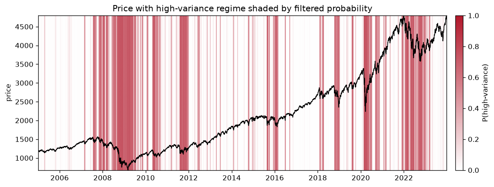
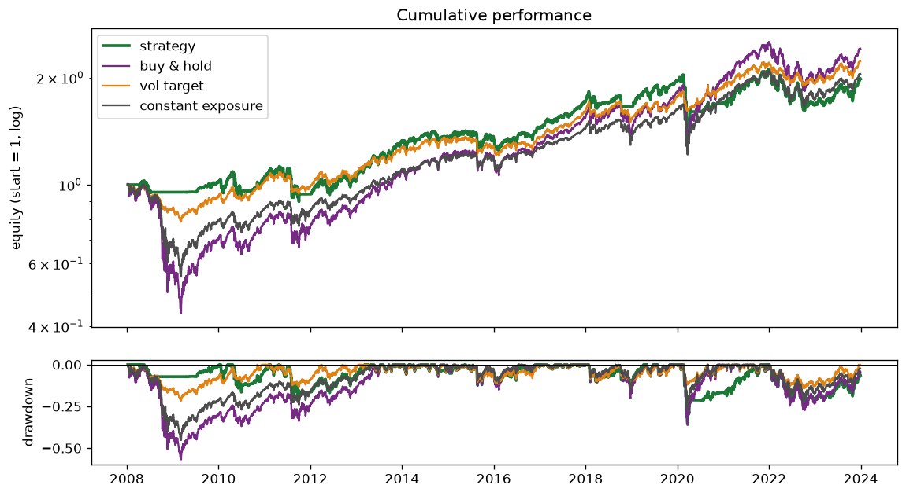

# Market regime detection with a hidden Markov model

[](https://github.com/tommasopongiluppi/regime-switching-hmm/actions/workflows/ci.yml)

Markov regime-switching analysis of daily equity index returns with a Gaussian hidden Markov model, implemented from scratch in NumPy and SciPy. The Python package is `regime_switching`.

## Summary

This project fits a two-state Gaussian hidden Markov model (HMM) to daily log returns of the S&P 500 and asks two questions: what regimes does the model find, and does knowing the regime in real time help a simple trading rule. The forward-backward recursions, Viterbi decoding, Baum-Welch estimation and Markov chain analytics are written in NumPy and SciPy. No HMM library is used inside the package. A test suite checks the inference code against brute-force enumeration of every state path, and checks the estimator against simulated data with known parameters and against statsmodels.

On 4,778 trading days from 2005-01-06 to 2023-12-29 the model separates a calm regime (daily standard deviation 0.0067, positive mean) from a turbulent one (daily standard deviation 0.0206, negative mean). In a walk-forward backtest evaluated from 2008-01-09 onwards, a rule that scales exposure by the filtered probability of the calm regime earns a Sharpe ratio of 0.37 net of costs, against 0.54 for a volatility-targeting benchmark and 0.37 for buy and hold. None of the Sharpe differences is statistically distinguishable from zero at conventional levels. On this sample the regime model does not add anything over inverse-volatility scaling, and that is the result reported here.

## Model

Let r_t be the daily log return and S_t an unobserved state in {0, ..., K-1}.

- The state follows a first-order Markov chain with transition matrix P, where P[i, j] = P(S_t = j | S_{t-1} = i) and rows sum to one.
- Given the state, the return is Gaussian: r_t | S_t = i is N(mu_i, sigma_i^2).
- The parameters are the initial distribution, the transition matrix, and the K means and variances. A K-state model has (K - 1) + K(K - 1) + 2K free parameters.

States are always sorted by ascending variance, so state 0 is the low-variance (calm) regime and the last state is the high-variance (turbulent) one. This keeps labels comparable across refits.

The model gives three state estimates that are easy to confuse:

- Filtered probabilities, P(S_t | r_0, ..., r_t), use information up to and including day t. They are the only estimate used to form positions.
- Smoothed probabilities, P(S_t | r_0, ..., r_{T-1}), use the whole sample. They describe regimes in hindsight and are used only for figures.
- The Viterbi path is the single most likely state sequence. It is not the same as picking the most likely state at each date separately, which can produce a sequence containing impossible transitions.

From the fitted transition matrix the package computes the stationary distribution, the expected duration of each regime, 1 / (1 - P[i, i]), the expected return time of each state, the modulus of the second eigenvalue and the relaxation time 1 / (1 - |lambda_2|). The chain module also covers hitting times, absorption probabilities and expected steps to absorption for general chains, and is exercised on textbook problems in the tests.

## Implementation

### Log-space forward-backward

Every recursion over time runs in log space. The forward pass computes log P(r_0, ..., r_t, S_t = i) and the backward pass log P(r_{t+1}, ..., r_{T-1} | S_t = i). The sum over states inside each step uses the max-trick form of logsumexp, inlined for speed and written so that entries equal to minus infinity (zero probabilities) do not produce NaN. Raw densities are never multiplied together. A naive forward recursion on daily returns underflows to exactly zero within a few hundred observations and, because zero is a valid float, gives no error when it does. One test runs a 10,000-observation sequence whose likelihood is far below the smallest positive double and confirms that every intermediate quantity stays finite.

Smoothed probabilities (gamma), pairwise transition posteriors (xi) and filtered probabilities are obtained by normalising in log space. Viterbi is the max-plus analogue of the forward pass with backpointers.

### Baum-Welch

The E-step computes gamma and xi with the log-space routines and exponentiates only the normalised posteriors. The M-step is closed form, and each update is a responsibility-weighted version of the ordinary estimator: the initial distribution is gamma at t = 0, a transition probability is the expected transition count divided by the expected time in the source state, a mean is the weighted sample mean and a variance is the weighted sample variance.

Initialisation matters because EM finds only a local optimum. The first start splits observations by quantiles of their trailing 21-day standard deviation and uses each group's mean and variance, with 0.95 on the diagonal of the transition matrix. The remaining starts draw means from a Gaussian matched to the sample, variances log-uniformly within a factor of e^1.5 of the sample variance, and diagonal transition entries uniformly between 0.90 and 0.97. Financial regimes are persistent, so sticky seeds rule out a family of poor rapidly-switching optima. Each start runs for at most 500 iterations and stops when the relative change in log-likelihood falls below 1e-8.

### Safeguards

1. Variance floor. Each state variance is bounded below (default 1e-10). Without it a state can collapse onto a single observation, its variance goes to zero and the log-likelihood diverges to plus infinity.
2. Monotonicity check. EM cannot decrease the log-likelihood. If it falls by more than 1e-6 in relative terms between iterations, the fit raises an error instead of continuing, because this almost always means the xi normalisation in the E-step is wrong.
3. Multi-start. The fit is repeated from several initialisations (10 in the pipeline, 20 by default in the model class) and the run with the highest final log-likelihood is kept. Every run's log-likelihood trace is retained and plotted.
4. Label ordering. The likelihood is invariant to relabelling states, so the fitted states are permuted into ascending-variance order, with the rows and columns of the transition matrix permuted consistently.

### Data and features

Prices come from Yahoo Finance through yfinance and are cached to parquet per ticker and date range. They are written to a DuckDB table with a primary key on (date, ticker). Re-running replaces overlapping rows, so the step is idempotent. Rolling features (21-day realised volatility, its 252-day z-score, drawdown from the running maximum, and the VIX level and change) are computed in a single SQL statement with window functions. Every window frame is of the form ROWS BETWEEN n PRECEDING AND CURRENT ROW, so no feature can use a future row. The VIX series is checked against the S&P 500 calendar and the run fails if it covers less than 80% of trading days. In this run it covered 4,781 of 4,781 days. Gaps are not forward-filled by default.

### Walk-forward backtest

The backtest refits the model on an expanding window every 63 trading days, starting once 756 observations (about three years) are available, which gave 64 refits here. At each refit the filtered probability at the last available close is held fixed for the following block. The position applied to the return of day t is the signal formed at the close of day t - 1. This one-day shift is enforced by an assertion in the code, and a test checks that the position column equals the lagged signal exactly. Exposure equals the held probability of the calm regime, capped at one, and transaction costs of 5 basis points are charged on every unit of turnover.

Three benchmarks are computed net of the same costs: buy and hold; volatility targeting, where exposure is 10% annualised divided by trailing 21-day realised volatility, capped at one and lagged one day; and a constant exposure equal to the strategy's average exposure, which separates the timing of the strategy from its average leverage. The comparison table reports standard performance statistics and the Jobson-Korkie test with Memmel's correction for the difference between the strategy's Sharpe ratio and each benchmark's. That test accounts for the correlation between the two return series. The strategy and all three benchmarks are evaluated over the same window, from the first refit date onwards, so the benchmarks are not credited with the warm-up period in which the strategy cannot yet hold a position.

## Verification

The suite has 55 tests. What each group rules out:

**Inference** (`tests/test_inference.py`)

- Brute-force enumeration. For a 3-state, 6-step chain with random parameters, every one of the 729 state paths is enumerated and its exact joint probability computed. The forward log-likelihood, gamma, xi and the Viterbi path must match the exact sums to 1e-10. This rules out errors in the recursions and in the normalisation of gamma and xi.
- Forward-backward agreement. The log-likelihood recovered from alpha_t + beta_t is the same at every t, so the two passes are consistent with each other.
- Gamma rows and xi slices sum to one, and xi marginalises to gamma.
- A one-state model reduces to the sum of log densities.
- A 10,000-step sequence stays finite where linear-space arithmetic would underflow to zero.
- A permutation transition matrix forces the Viterbi path onto the known cycle.
- Filtered and smoothed probabilities coincide only at the final step and differ before it, which guards against the two being swapped.
- The Gaussian log density matches scipy.stats.norm.logpdf.

**Estimation** (`tests/test_estimation.py`)

- Recovery from simulated data. A 50,000-step series is drawn from known parameters. The fit must recover the means within 15%, the standard deviations within 10% and every transition probability within 0.02. This is the test that the EM machinery as a whole is correct.
- The log-likelihood is non-decreasing in every multi-start run.
- Two fits with different seeds return the same parameters, so label switching is resolved.
- A one-state fit returns the sample mean and population variance exactly.
- A long run of identical values does not blow up the likelihood (variance floor).
- The log-likelihood of the fitted model agrees with statsmodels' MarkovRegression within 0.5%. statsmodels is used only in this test.
- Save and load round-trip exactly.
- BIC selects K = 2 on data simulated from a two-state model.
- Bad input (NaN, too few observations, K = 0, an unfitted model) raises an informative error.

**Chain analytics** (`tests/test_chain.py`)

- Closed forms: the two-state stationary distribution, the uniform stationary distribution of a doubly stochastic matrix, return time equal to 1 / pi, expected durations from the diagonal, and the second eigenvalue and relaxation time of a two-state chain.
- Gambler's ruin, fair and biased, against the textbook absorption probabilities and expected durations.
- Pattern waiting times: a fair coin needs 10 flips on average to show HTH and 8 to show HHT.
- Hitting times satisfy the first-step recursion. n-step matrices converge to the stationary rows. Irreducibility and aperiodicity flags are correct on an ergodic chain, a cycle and a reducible chain. Simulated state frequencies match the stationary distribution.

**Data** (`tests/test_data.py`)

- Realised volatility, drawdown and VIX change computed in SQL match pandas rolling, cumulative-max and diff computations.
- Causality under truncation. Every feature at rows 0 to t is bit-identical when all rows after t are deleted from the database, for four values of t. This is the test that the window frames cannot see the future.
- The database build is idempotent, and an unknown market raises.
- One network-marked test downloads live data and is deselected by default.

**Backtest and metrics** (`tests/test_backtest.py`, `tests/test_metrics.py`)

- Oracle test. Given the true state sequence of a simulated series the strategy beats buy and hold by a wide margin. Given a shuffled state sequence it does not. This shows the machinery detects signal when signal exists and not otherwise.
- The position column is exactly the one-day lag of the regime signal, and truncating the input leaves all earlier positions unchanged.
- Zero cost equals gross return, and higher costs strictly reduce cumulative net return.
- The Jobson-Korkie-Memmel statistic is zero for identical series and rejects at the 5% level when one series has a higher Sharpe ratio. The deflated Sharpe ratio falls as the number of trials rises. Turnover takes its known values.

**End to end** (`tests/test_run_analysis.py`)

- Two runs of the full pipeline with the same seed produce identical comparison tables, BIC values and CSV files.

Four long-running tests (the three heaviest estimation tests and the end-to-end check) carry a `slow` marker and are deselected by default. See "How to reproduce".

## Results

All numbers below come from one run of `scripts/run_analysis.py` on 2026-11-03 with default settings: S&P 500 (^GSPC) and VIX (^VIX) from Yahoo Finance, 2005-01-06 to 2023-12-29, 4,778 daily log returns after the feature warm-up, seed 20260721, 10 EM starts per fit. The run took 59 minutes on a laptop. Yahoo may revise historical prices, so a later download can differ slightly.

### Fitted two-state model

Full-sample fit, log-likelihood 15,411.2, converged.

| State | Daily mean | Daily std | Annualised mean | Annualised vol | P(stay) | Expected duration | Stationary prob. |
| --- | ---: | ---: | ---: | ---: | ---: | ---: | ---: |
| 0 (calm) | +0.00089 | 0.0067 | +22.5% | 10.7% | 0.9863 | 73 days | 72% |
| 1 (turbulent) | -0.00127 | 0.0206 | -32.0% | 32.6% | 0.9644 | 28 days | 28% |

Transition matrix, P(S_t = column | S_{t-1} = row):

| | calm | turbulent |
| --- | ---: | ---: |
| calm | 0.9863 | 0.0137 |
| turbulent | 0.0356 | 0.9644 |

The turbulent regime has 3.1 times the daily standard deviation of the calm one and a negative mean. The chain spends 72% of the time in the calm regime in the long run. The second eigenvalue has modulus 0.9508, so the relaxation time is 20.3 trading days: that is the time scale on which the state distribution forgets where it started.

BIC for K = 2, 3, 4 on the same sample (lower is better):

| K | BIC |
| --- | ---: |
| 2 | -30,763 |
| 3 | -31,219 |
| 4 | -31,290 |

BIC prefers K = 4. The pipeline still uses K = 2. With fat-tailed daily returns, extra Gaussian states tend to absorb tail days rather than describe distinct persistent regimes, and two states keep the regime signal and the walk-forward comparison interpretable. The BIC preference is reported here rather than hidden.



The figure shows the S&P 500 level with red shading whose opacity is the filtered probability of the turbulent regime on each day, so it uses only information available at the time. The shading is dense through 2007 to 2009, in 2010 and 2011, early 2016, late 2018, early 2020 and 2022, and is faint in 2013, 2014 and 2017.

### Walk-forward results versus the benchmarks

All four series are net of 5 basis points per unit of turnover and are evaluated over the same period, from the first refit date 2008-01-09 to 2023-12-29 (4,022 trading days). The 756 days before the first refit are the training window for the first model fit and are excluded for every series. The constant-exposure benchmark is buy and hold scaled to the strategy's average exposure of 0.74, so its Sharpe ratio equals buy and hold's by construction.

| | Strategy | Buy and hold | Vol target | Constant exposure |
| --- | ---: | ---: | ---: | ---: |
| CAGR | +4.39% | +5.67% | +5.15% | +4.59% |
| Annualised vol | 14.2% | 20.5% | 10.2% | 15.2% |
| Sharpe | 0.37 | 0.37 | 0.54 | 0.37 |
| Sortino | 0.51 | 0.51 | 0.74 | 0.51 |
| Max drawdown | -35.7% | -56.8% | -21.7% | -45.2% |
| Calmar | 0.12 | 0.10 | 0.24 | 0.10 |
| Hit rate | 54.0% | 54.1% | 53.9% | 54.1% |
| Skew | -1.05 | -0.52 | -0.64 | -0.52 |
| Excess kurtosis | 25.4 | 12.2 | 2.2 | 12.2 |
| JK-Memmel z vs strategy | | +0.01 | -1.02 | +0.01 |
| JK-Memmel p-value | | 0.990 | 0.307 | 0.990 |



What the table says:

- The volatility-targeting benchmark has the highest Sharpe ratio (0.54) and the smallest maximum drawdown (-21.7%). The regime strategy's Sharpe ratio (0.37) is level with buy and hold and constant exposure (0.37); the Jobson-Korkie-Memmel test against buy and hold gives z = +0.01, p = 0.990.
- The Sharpe difference against volatility targeting has p = 0.307. Neither comparison comes close to rejecting equal Sharpe ratios, so the strategy is not distinguishable from the benchmarks on this sample, and the point estimates favour volatility targeting.
- On compounded return the strategy (+4.39% a year) is the lowest of the four over this window, below constant exposure (+4.59%) at the same average exposure of 0.74. Its timing cost return relative to simply holding that exposure.
- The strategy's maximum drawdown (-35.7%) is smaller than buy and hold's (-56.8%) and constant exposure's (-45.2%). The first refit, in January 2008, put the probability of the calm regime at 0.001, so the strategy was essentially out of the market through the 2008 to 2009 fall. The equity figure shows its line flat for most of 2008 and 2009 while buy and hold loses more than half.
- The strategy's own worst drawdown came in 2020, not 2009. Its excess kurtosis (25.4) is far above the benchmarks' because it was largely invested going into the February to March 2020 fall and took most of that loss in a few days, while the volatility-targeting benchmark cut exposure as realised volatility rose and lost less.

## Limitations

- Price indices exclude dividends. The S&P 500 price index understates the return to holding by roughly 1.5 percentage points a year, which flatters every strategy measured against buy and hold. The European configuration (EURO STOXX 50, VSTOXX) is affected more and is not reported here.
- Returns are modelled as Gaussian within each state. Daily returns have heavier tails than a two-component Gaussian mixture captures, and the BIC preference for K = 4 reflects that.
- The strategy return is computed as position times the daily log return. For a position between zero and one this is a close approximation to the simple return but not identical.
- Costs are a flat 5 basis points per unit of turnover. There is no slippage model, no financing cost and no borrowing constraint beyond a cap of one on exposure.
- The Sharpe standard error assumes independent returns and the Jobson-Korkie-Memmel test is asymptotic. Both understate uncertainty when returns are autocorrelated or fat-tailed.
- One market, one asset, one set of default parameters. No parameter search was run, which avoids selection bias but also means the result is a single configuration.
- The time loop in the forward and backward passes is Python, vectorised only across states. The full pipeline took 59 minutes, dominated by the walk-forward refits.
- The data come from Yahoo Finance and are not an audited source.

## How to reproduce

Requires Python 3.10 or later.

```bash
git clone https://github.com/tommasopongiluppi/regime-switching-hmm.git
cd regime-switching-hmm
pip install -e ".[dev]"
```

Run the full pipeline on the S&P 500 and VIX (downloads from Yahoo Finance and caches the data):

```bash
python scripts/run_analysis.py --market us
```

Outputs:

- `results/us_summary.csv`: the comparison table above, at full precision.
- `figures/us/`: `regimes.png`, `transition_matrix.png`, `regime_distributions.png`, `loglik_traces.png`, `equity_curves.png` and `filtered_vs_smoothed.png`.
- `data/us.duckdb` and the parquet cache.
- A plain-text report on standard output.

The run is deterministic given the seed (`--seed`, default 20260721). It took 59 minutes here. For an offline run that exercises the whole pipeline on a simulated two-regime series, pass `--synthetic`. `scripts/compare_markets.py` runs both market configurations and `scripts/study_chains.py` prints worked Markov-chain examples.

Tests:

```bash
pytest                    # default: 50 passed, 5 deselected, 85 s here
pytest -m slow            # the four long tests, about 35 minutes
pytest -m "not network"   # fast and slow together
```

The CI workflow in `.github/workflows/ci.yml` runs ruff and the default test suite on every push to main and on pull requests.

Versions used for the numbers in this README: Python 3.13.0, numpy 2.5.4, scipy 1.18.1, pandas 3.1.0, duckdb 2.0.0, matplotlib 3.11.2, yfinance 1.7.0, pyarrow 26.0.0.

## Package layout

| Module | Purpose |
| --- | --- |
| `inference.py` | Log-space forward, backward, gamma, xi, filtered probabilities, Viterbi |
| `estimation.py` | Baum-Welch EM with multi-start and the four safeguards |
| `hmm.py` | `GaussianHMM`: fit, score, predict, predict_proba, filter, sample, AIC/BIC, save/load |
| `chain.py` | Markov chain analytics on a transition matrix |
| `data.py` | Price download and cache, DuckDB store, SQL feature engineering |
| `backtest.py` | Walk-forward regime detection, strategy sizing, benchmarks, comparison |
| `metrics.py` | Performance statistics, Sharpe standard error, Jobson-Korkie-Memmel, deflated Sharpe |
| `plots.py` | Figures |

## License

MIT. See `LICENSE`.
